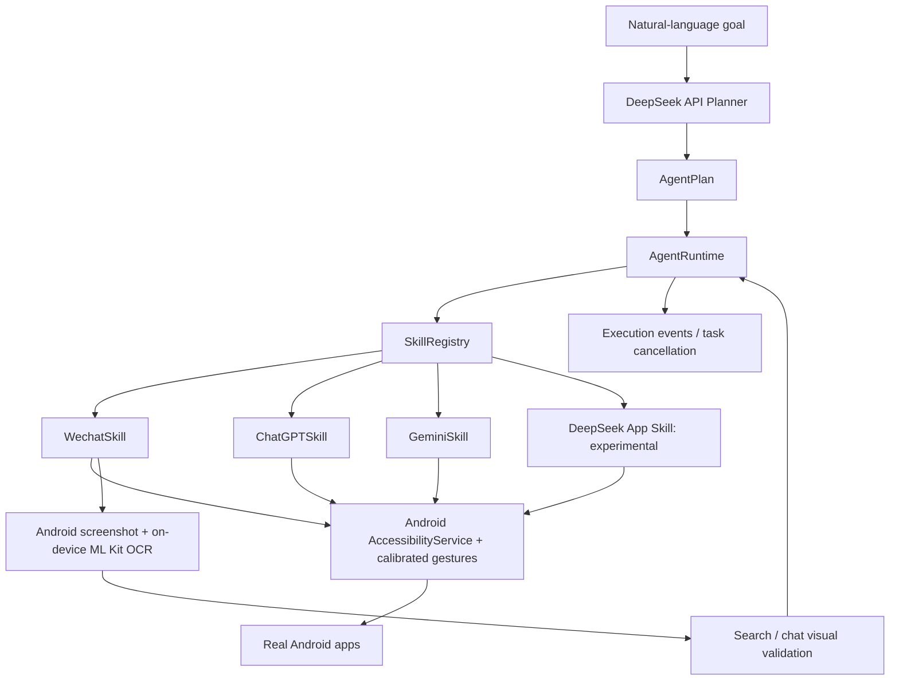

# MobileAgent

**Experimental Android-native Agent Runtime Prototype** — `v0.1` (release candidate)

> Turns natural-language goals into structured plans and executes them on a real Android device through a modular Skill runtime.
>
> **Not a WeChat bot.** WeChat is one validation Skill within a broader Android Agent Runtime.

**Status:** real-device prototype. No full autonomous agent loop; no production reliability guarantee. Please complete the checks in the checklist before tagging a release in [`docs/release-checklist.md`](docs/release-checklist.md).

## Demo

**Video:** to be added after recording (not included in this source archive).

The intended main demo shows:

1. A natural-language request is converted into a structured plan by the LLM Planner.
2. `AgentRuntime` routes actions through `SkillRegistry` into `WechatSkill`.
3. On-device execution searches a WeChat contact, uses **Android system screenshots + local ML Kit OCR** to verify the match and its row, then performs calibrated Android gestures.
4. A second screenshot-based check verifies the target chat screen before message entry.
5. The runtime reports execution events; searching for a nonexistent contact stops safely instead of blindly tapping or claiming success.
6. A separate demo uses `ChatGPTSkill` or `GeminiSkill` to show multi-Skill dispatch (basic prompt submission was reported working on the release device).

> Observing a gesture complete is not the same thing as verifying business success. v0.1 has **partial** visual verification, not independently proven message delivery.

## Architecture



This is currently a **plan → skill execution → events** prototype, **not** a general-purpose observe–reason–act Agent Loop. See [`docs/architecture.md`](docs/architecture.md).

## Skills and honest current scope

| Skill | Current role | v0.1 release status |
| --- | --- | --- |
| `WechatSkill` | Search and send multiple messages via real UI, local contact alias resolution, calibrated gestures and screenshot/OCR guards | Maintainer-reported working, including stopping on nonexistent contacts; final A–G record pending |
| `ChatGPTSkill` | Open app, enter a prompt, request send | Maintainer-reported basic prompt submission working |
| `GeminiSkill` | Open app, enter a prompt, request send | Maintainer-reported basic prompt submission working |
| `DeepSeekSkill` (Android app) | Open app and attempt prompt submission | **Experimental — sending currently unreliable; not in main demo** |
| DeepSeek **API Planner** | LLM-generated structured plan | Distinct from the DeepSeek Android app Skill |

`ChatGPTSkill`, `GeminiSkill` and `DeepSeekSkill` are currently **UI action Skills**. They do not form a full loop that reads model answers and autonomously replans.

## Build (source release only)

- Android Studio with an Android SDK matching the checked-in Gradle project; Java/Kotlin/AGP versions follow the **actual** repository configuration.
- Android device with Accessibility enabled, and required target apps installed.
- Configure `DEEPSEEK_API_KEY` **locally** in the ignored `local.properties`, following the repository's actual `BuildConfig` wiring (see below).
- Keep the following ML Kit dependencies in `app/build.gradle.kts` if using the v0.1 visual observer:

```kotlin
implementation("com.google.mlkit:text-recognition:16.0.1")
implementation("com.google.mlkit:text-recognition-chinese:16.0.1")
```

- The actual Accessibility service XML referenced by `AndroidManifest.xml` must include screenshot capability (`android:canTakeScreenshot="true"`), in addition to gesture capability. Toggle the service off/on after changing its configuration.
- Build and install from Android Studio, then explicitly enable the Accessibility service in Android system settings. The app cannot grant this permission itself.

Example `local.properties` **entry only** (do not replace your `sdk.dir` or other local properties):

```properties
DEEPSEEK_API_KEY=your_own_api_key_here
```

**Do not distribute an APK built with your personal API key.** `BuildConfig` values are extractable from APKs even if their source file is gitignored. See [`docs/security.md`](docs/security.md).

## Tested environment

- Maintainer reports successful device tests; the exact device model / Android version should be confirmed before documenting a compatibility claim.
- WeChat client version: **[RECORD EXACT VERSION BEFORE RELEASE]**.
- Maintainer reports three successful WeChat test runs and safe stopping on nonexistent contacts; raw test logs were not included in this source archive. See [`docs/test-record.md`](docs/test-record.md).
- Not guaranteed across Android device vendors, resolutions, keyboards, or changes in WeChat UI.

## Privacy and safety

- Contact profiles / aliases are local app data, **not** a mandatory allowlist.
- For this WeChat v0.1 path, OCR uses an on-device bundled model on Android screenshots; images are not intentionally sent to the Planner or cloud visual models by this observer.
- **Planner requests still use an external DeepSeek API**; do not treat all app content as entirely offline.
- Screenshot and accessibility privileges are sensitive. Only enable for personal, consented workflows; redact names, chats and notifications in public demos.
- UI automation has failure modes; never use it for high-stakes or unattended messaging.

## Documentation

- [Architecture](docs/architecture.md)
- [Known limitations](docs/limitations.md)
- [Roadmap](docs/roadmap.md)
- [Security / privacy](docs/security.md)
- [Release checklist](docs/release-checklist.md)
- [Device testing record](docs/test-record.md)
- [Demo storyboard](docs/demo-storyboard.md)
- [Release notes](docs/release-notes.md)

## License

This source archive includes an **MIT license template** (`LICENSE.MIT.template`), **not** an authorized license grant. Before publishing, choose a license, replace the copyright holder and filename as appropriate, and commit the actual `LICENSE` file. Third-party software remains under its own license terms.

## 中文说明

MobileAgent 是 **Android 原生的通用 Agent Runtime 原型**；微信只是第一个验证 Skill。当前版本演示自然语言规划、模块化 Skill 调度、真实 Android 手势执行以及基于系统截图 + 本地 OCR 的微信搜索安全熔断。它并不是完整 Agent Loop。DeepSeek **App Skill** 发送不稳定，标记为 Experimental；DeepSeek **API Planner** 是另一套独立功能。
